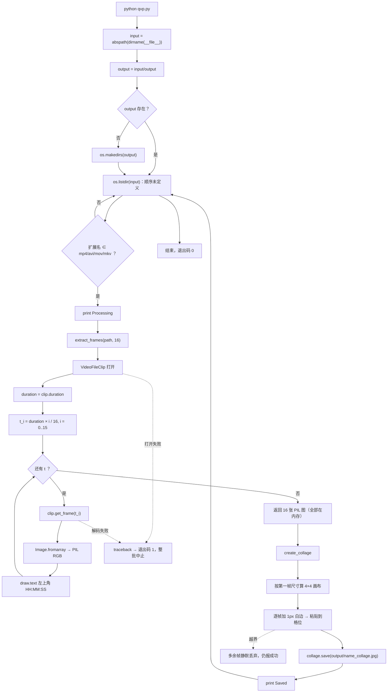
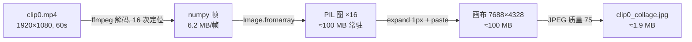

# 01 · 现有实现拆解

`qvp.py` v1.1.0：76 行、3,508 字节、3 个函数、4 个模块级常量，无命令行参数、无返回值、无异常处理。

本文只描述**代码现在做什么**，不评价好坏；评判放在 [02-review.md](02-review.md)。

## 1. 模块级符号

| 符号 | 行 | 类型 | 说明 |
|---|---|---|---|
| `os` | 1 | import | 目录遍历、路径拼接、建目录 |
| `VideoFileClip` | 2 | import | moviepy 2.x 的解码入口 |
| `Image, ImageOps, ImageDraw, ImageFont` | 3 | import | 帧对象、白边、文字、字体 |
| `NUM_FRAMES = 16` | 6 | 常量 | 每个视频截取的帧数，同时也是网格单元数 |
| `GRID_SIZE = (4, 4)` | 7 | 常量 | 列 × 行 |
| `BORDER_SIZE = 1.25` | 8 | 常量 | 每帧白边宽度，注释说“像素” |
| `TEXT_COLOR = "red"` | 9 | 常量 | 时间戳颜色 |
| `extract_frames(video_path, num_frames=16)` | 12–33 | 函数 | 解码 → 打时间戳 → 返回 PIL 图像列表 |
| `create_collage(images, output_path, grid_size=(4,4), border_size=1.25)` | 36–56 | 函数 | 加白边 → 拼贴 → 存 JPEG |
| `process_videos(input_folder, output_folder)` | 59–71 | 函数 | 遍历目录 → 逐个调用上面两个函数 |
| `__main__` 块 | 73–76 | 入口 | 用脚本自身所在目录当输入目录 |

三个函数都是**纯过程**：没有返回值（`extract_frames` 例外），没有日志，没有错误信号。

## 2. 逐行行为

| 行 | 行为 | 读/写 | 失败时 |
|---|---|---|---|
| 13 | `VideoFileClip(video_path)` 打开容器并启动 ffmpeg 解码进程 | 读视频 | 抛异常，整批中止 |
| 14 | `duration = clip.duration` 取时长（秒，float） | 读元数据 | 对无时长容器得到 `None`，第 15 行 `None * i` 抛 `TypeError` |
| 15 | `frame_times = [duration * i / num_frames for i in range(num_frames)]` | 计算 | `num_frames = 0` 得空列表，后续 `images[0]` 抛 `IndexError` |
| 17–18 | 逐点 `clip.get_frame(t)` 解码 | 读视频 | 解码失败抛异常 |
| 19 | `Image.fromarray(frame)` 把 numpy 帧转成 PIL 图 | 内存 | — |
| 20 | `ImageDraw.Draw(img)` | 内存 | — |
| 23–25 | `int(t)` 取整后拆成时/分/秒，格式化为 `HH:MM:SS` | 计算 | — |
| 26–29 | 尝试 `ImageFont.truetype("arial.ttf", 26)`，失败退回 `load_default()` | 读系统字体 | 回落字体只有 40×8 像素（实测） |
| 30 | `draw.text((10, 10), ...)` 在左上角画红字 | 内存 | — |
| 32 | 收集帧，**全部留在内存** | 内存 | 16 帧 1080p ≈ 100 MB |
| 38 | `images[0].size` 取第一帧尺寸 | 内存 | 列表空 → `IndexError` |
| 39–40 | `int(width + 2 * 1.25)` → 实际等于 `width + 2` | 计算 | `int(1.25) = 1`，白边只有 1 像素 |
| 43–44 | 画布尺寸 = 列数 × 带边宽，行数 × 带边高 | 计算 | — |
| 45 | `Image.new('RGB', ..., 'white')` 建整张画布 | 内存 | 1080p → 100 MB；4K → 399 MB |
| 47–54 | 逐帧 `ImageOps.expand(border=1)` 后粘贴到网格位置 | 内存 | 帧数 > 格数时越界部分被静默裁掉 |
| 56 | `collage.save(output_path)` 直接写目标文件 | 写磁盘 | 中途失败留下半张图 |
| 60–61 | 输出目录不存在则创建 | 写磁盘 | 权限不足时抛异常，整批中止 |
| 63 | `os.listdir(input_folder)` 取目录项，**顺序未定义** | 读目录 | — |
| 64 | 扩展名小写后比对 4 种容器 | 计算 | 只认这 4 种，`.webm`、`.flv`、`.m2ts` 被忽略 |
| 66 | 输出名 = `<主文件名>_collage.jpg` | 计算 | 已存在的同名文件被覆盖，没有提示 |
| 68–71 | 打印两行进度，异常时无任何汇总 | 标准输出 | 中途异常会带着 traceback 退出，后续视频不再处理 |
| 74 | `os.path.abspath(os.path.dirname(__file__))` 取脚本所在目录当输入 | 计算 | 用户无法指定别的目录 |
| 76 | 调用 `process_videos`，返回值被丢弃 | — | 进程退出码恒为 0 或 1（未捕获异常） |

## 3. 主流程

异常路径只有一种形态：**任何一步抛异常 → traceback → 进程退出 → 后面的视频全部不处理**。没有 try/except，没有逐文件隔离，没有汇总。

## 4. 数据流（像素与内存）

峰值内存 ≈ 画布 + 16 帧 ≈ **200 MB**（1080p）；4K 源 ≈ **800 MB**。

## 5. 隐含假设

代码没有写、但运行必须成立的九件事：

| # | 假设 | 违背时 |
|---|---|---|
| A1 | `clip.duration` 是正数 float | `None` → `TypeError`；`0` → 16 帧全是第 0 秒 |
| A2 | `num_frames ≥ 1` | `0` → `IndexError`（实测 rc=1） |
| A3 | `grid 宽 × 高 ≥ num_frames` | 超出部分静默丢弃（实测 20 帧/4×4，rc=0） |
| A4 | 目标目录可写 | 抛 `PermissionError`，整批中止 |
| A5 | 视频容器能被 ffmpeg 打开 | 抛异常，整批中止（实测：坏文件在首位时后面的好文件一个都没处理） |
| A6 | 所有帧尺寸一致 | 同一视频内成立 |
| A7 | 系统里有 `arial.ttf` | 回落成 40×8 点阵字体，几乎不可读 |
| A8 | `__file__` 存在且指向真实路径 | `python -c`、zipapp、被 import 时不可靠 |
| A9 | Pillow 的 `fromarray` 已经复制像素 | 若共享内存，`with` 退出关闭解码器后帧会失效（当前实现依赖此行为，未显式 `.copy()`） |

## 6. 失败模式矩阵

| 输入 | 实际行为 | 证据 |
|---|---|---|
| 正常单个视频 | 成功，`output/x_collage.jpg`，退出码 0 | `probe-flow/01_default`，9.35 s |
| `NUM_FRAMES = 0` | `IndexError: list index out of range`，退出码 1 | `probe-flow/02_frames_0` |
| `NUM_FRAMES = 20`，格 4×4 | **静默丢弃 4 帧**，仍报成功，退出码 0 | `probe-flow/03_frames_20_grid_4x4`，13.37 s |
| 坏视频排在前面 | 整批中止，后面的好文件一个都不处理 | `probe-flow/04_bad_video_first`，`produced=[]` |
| 两个视频 | 串行处理，17.79 s | `probe-flow/05_two_videos` |
| 无 `arial.ttf` | 时间戳 40×8 像素（Arial 26 是 101×19） | Pillow 实测 |
| 输出已存在 | 覆盖写，无提示 | 代码 `qvp.py:56` |
| 目录里没有视频 | 建了 `output/` 空目录后正常退出，无任何输出 | 代码 `qvp.py:60-63` |
| 视频超过 4 个 | 仍按字母序以外的顺序处理（`listdir` 顺序） | 代码 `qvp.py:63` |
