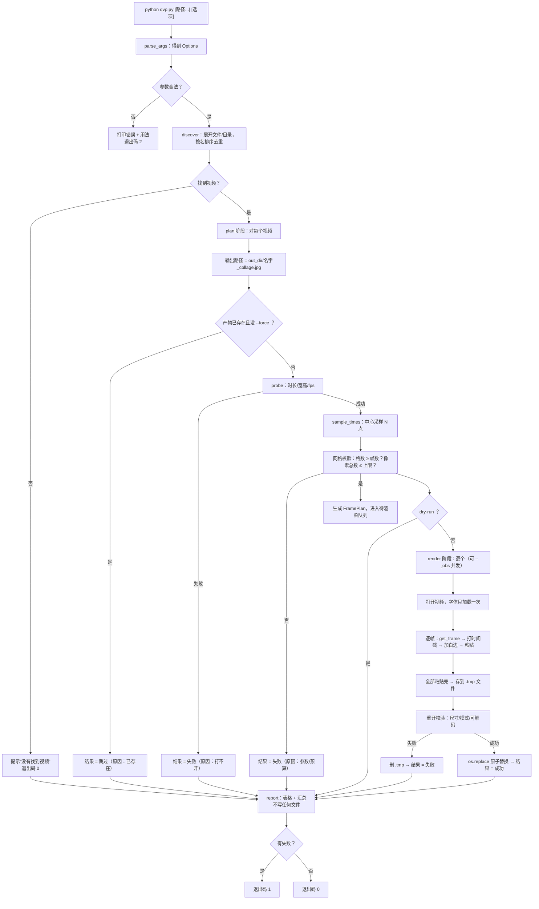

# 03 · 新流程设计

目标：把 [02-review.md](02-review.md) 的 8 条不变量落到一个**分阶段、可判定、可测试**的流程里，同时保持“下载一个文件就能跑”的分发方式。

## 1. 设计原则

| 原则 | 落点 |
|---|---|
| 先计划、后执行 | 两个阶段分离：`plan` 只算（不写盘），`render` 才做（写临时文件）。`--dry-run` 直接停在 plan 之后 |
| 失败隔离在单文件 | 每个视频一个 `Result`，异常在 render 内捕获并归类，绝不冒泡到整批 |
| 成功必须被校验 | 写完临时文件后重新打开校验尺寸/模式，通过才 `os.replace` |
| 纯计算与 I/O 分离 | 采样点、时间格式、网格布局、输出命名、字体选择都是纯函数 |
| 资源有预算 | 逐帧粘贴（画布 + 1 帧），像素总数上限，超限按文件失败而不是整体 OOM |
| 默认不破坏 | 默认跳过已存在的产物；`--force` 才覆盖；输入只读 |
| 可判定 | 每个文件的状态/原因/耗时进表格，退出码与汇总一致 |

## 2. 流程



与旧流程的形状差别：

```text
旧：发现 ─► 解码 ─► 标注 ─► 拼贴 ─► 落盘 ─► 打印      （一个异常域）
新：发现 ─► 计划（只算）─► 渲染（逐文件隔离）─► 报告   （两个阶段，失败变数据）
```

## 3. 各阶段的契约

| 阶段 | 输入 | 输出 | 失败语义 |
|---|---|---|---|
| `parse_args` | `argv` | `Options` | 参数错 → `UsageError` → 退出码 2 |
| `discover` | 路径列表、`recursive` | 排序去重后的 `list[Path]` | 不存在的路径 → 报告里标“未找到”，不算致命 |
| `plan` | `Path`、`Options` | `Plan`（含 `FramePlan`）或 `Result(skipped/failed)` | 打不开/预算超限 → 该文件失败，其余继续 |
| `render` | `Plan` | `Result(ok)` | 任何异常 → 该文件失败，临时文件清理，其余继续 |
| `report` | `list[Result]` | 表格 + 汇总 + 退出码 | — |

`plan` 不写盘，所以 `--dry-run`、覆盖判断、预算检查都能在“零副作用”的前提下完成——这是旧流程做不到的。

## 4. 关键决策

### 4.1 仍是单文件 `qvp.py`

分发方式是“下载一个文件放进视频文件夹”，拆成包会毁掉这个体验。代价是文件变长（约 740 行），用分区注释 + 纯函数分层来补偿：**文件内按“常量 / 纯函数 / I/O / 编排 / CLI”分段**，测试通过 `import qvp` 直接调用纯函数。

### 4.2 采样：端点包含 + 两端内缩

```
旧：t_i = duration * i / N            i = 0..N-1  → 第一格 0 秒（常是黑场），最后一格只到 93.75%
新：first = min(max(2% 时长, 0.1s), 0.5s)，last = duration − 1.5 帧
    t_i = first + i × (last − first) / (N − 1)
```

- 第一格落在 0.1–0.5 秒之间：长片取 0.5 秒，4 秒短片取 0.1 秒，既能跳过纯黑片头，又不丢开场内容；
- 最后一格停在结束前 1.5 帧：0.3 秒 / 10 fps 的短片也有画面可解，不会“越过末帧”导致整个文件失败；
- 时间戳按四舍五入取整（`floor(t + 0.5)`），避免 `59.999 s` 显示成 `00:00:59` 却对应第 60 秒的画面。

最初实现试过“中心采样”（每格取区间中点），实测发现它把第一格推到全片 3% 处，片头标题被完全跳过，于是改成现在的端点方案。

### 4.3 逐帧粘贴，而不是“先收 16 帧再拼”

```
旧：16 帧全部留在内存 → 再建画布 → 再逐帧粘贴
新：建画布 → 每解出一帧立刻粘贴、随即丢弃
```

设计意图是省掉“16 帧列表”，但实测（1080p 1080 帧源、4K 6 秒源）峰值几乎不变：

| 源 | v1 峰值 | v2 峰值 | 成因 |
|---|---|---|---|
| 1080p ×16 | 303 MB | **207 MB** | 画布 100 MB + JPEG 缓冲 100 MB + 解释器；校验改成 1/8 解码后降下来 |
| 4K ×16 | 1,115 MB | **699 MB** | 画布 400 MB + JPEG 缓冲；校验不再整张重解码 |

也就是说，真正的内存大头是**画布本身加 JPEG 编码缓冲**，帧列表只占其中一部分。第一轮实测还发现“校验时把整张 JPEG 重新解码”会再多占一整份画布，改成只读文件头 + 1/8 解码后，1080p 从 309 MB 降到 207 MB，4K 从 1,137 MB 降到 699 MB。结论：

- 逐帧粘贴仍然保留（逻辑更简单，4K 下不会再额外多一份帧数组的拷贝）；
- 用 `--max-pixels`（默认 2 亿像素）在 plan 阶段拒绝超预算的活，而不是让机器换页；
- 文档如实写明“1080p 4×4 约 300 MB、4K 4×4 约 1.1 GB”。

### 4.4 白边是整数像素，默认 2

旧常量 `1.25` 被 `int()` 截成 1 px，注释却写“像素”。新实现里 `--border` 是整数（默认 2），并在文档里写清是“每边像素”。

### 4.5 时间戳：自适应字号 + 描边

- 字号 = `clamp(round(cell_width * 0.022), 12, 96)`，可用 `--font-size` 覆盖；
- 用 `stroke_width = max(1, size // 12)`、`stroke_fill = black`：红字在红色/白色画面上都能读；
- 字体候选（按平台）：`arial.ttf` → `DejaVuSans.ttf` → `Helvetica.ttc` → `PingFang.ttc` → `msyh.ttc`，全失败才用 `ImageFont.load_default(size=...)`（Pillow ≥ 9.2 支持带尺寸的默认字体）；
- 字体对象**每个视频只加载一次**，不再每帧 `truetype()`。

### 4.6 时间格式自适应

`< 1 小时` 用 `MM:SS`（`00:26`），`≥ 1 小时` 用 `H:MM:SS`（`1:02:05`）；`--time-format hms` 可强制旧格式。理由是 26 分钟的片子每格都顶着 `00:00:26` 的六字符前缀，在缩略图尺寸下占地方且没有信息量。

### 4.7 输出：默认跳过，`--force` 覆盖

```text
output/lecture-01_collage.jpg 已存在 → 跳过（原因：已存在，用 --force 覆盖）
```

覆盖必须显式，避免手工修过的一张图被无声抹掉。

### 4.8 原子写

写到同目录 `.<name>_collage.jpg.tmp-<pid>` → 重新打开校验 `size`、`mode == "RGB"`、可 `load()` → `os.replace()`。失败则删临时文件。这样中断不会留下半张图，也不会让下次运行把坏图当成品。

### 4.9 并发只到“文件”这一层

`--jobs N` 用 `ThreadPoolExecutor`：解码主要在 ffmpeg 子进程里，线程能重叠 I/O 与等待；内存按“并发数 × 单文件峰值”增长，所以默认 `1`，并在文档里给出公式。

### 4.13 并行取帧（v2.3）

一帧 = 一次 ffmpeg：seek 到前一个关键帧再解码到目标时刻，单进程已经把多核用满（`-threads 1` 慢一倍），所以提速只能靠**重叠多个 seek**。`decode_plan()` 给出 `workers = min(4, cpu/4, 帧数)`、`threads = cpu/workers`；取帧线程池领先合成器 `workers+1` 帧，产物顺序不变。实测 1.3–2.3×，详见 [07-performance.md](07-performance.md)。

### 4.12 网格按片长自动选择（v2.1）

固定 4×4 对 2 分钟的片子意味着每 7.5 秒一格（重复），对 2 小时的片子意味着每 7.5 分钟一格（整章漏掉）。因此 v2.1 把网格也交给流程决定：

```
2x2 (≤20 s) / 3x2 (≤40 s) / 3x3 (≤1 min) / 4x3 (≤3 min)
/ 4x4 (≤5 min) / 5x4 (≤12 min) / 5x5 (更长)
然后按 --max-pixels 沿阶梯逐级降，最低 2x2
```

阈值、推导、真实素材分布见 [06-auto-grid.md](06-auto-grid.md)。实现上 `auto_grid()` 是纯函数，`plan` 阶段按每个视频的时长单独求值；`-g 4x4` 仍可强制固定。

### 4.11 帧提取：优先系统 ffmpeg

第一版实现按 moviepy 的 `clip.get_frame(t)` 取帧，实测 60 秒 1080p AV1 要 11.5 秒。原因是 moviepy 每次跳转都会重启解码器，等于把片子从头解到目标位置。

改成“每帧一次 `ffmpeg -ss t -i in -frames:v 1 -f rawvideo`”后降到 8.5 秒。再对比两种 ffmpeg 二进制（同一台机器、同一个文件）：

| 二进制 | 全片解码 60 s / 1080p AV1 | 单帧 seek |
|---|---|---|
| 系统 ffmpeg 7.1（gyan 完整版，209 MB） | **1.59 s** | **0.14 s** |
| moviepy 自带的 imageio 副本（85 MB） | 6.78 s | 0.31 s |

差别来自编解码器支持：自带副本解 AV1 明显更慢。最终策略是三级回退：

```
--ffmpeg 指定 → 系统 PATH 里的 ffmpeg → moviepy 自带的副本 → moviepy 逐帧
```

任何一级解不出“第一帧”就换下一级；全部失败才判该文件失败。这样既吃到系统 ffmpeg 的速度，又不会在只装了 moviepy 的机器上跑不起来。
### 4.10 兼容旧用法

模块级仍保留四个常量 `NUM_FRAMES / GRID_SIZE / BORDER_SIZE / TEXT_COLOR` 作为默认值——直接改文件顶部的老用户不受影响；命令行参数覆盖它们。默认输出目录、默认文件名（`<stem>_collage.jpg`）也保持不变。

## 5. 命令行

```text
python qvp.py [路径 ...] [选项]
```

| 参数 | 默认 | 说明 |
|---|---|---|
| `路径` | 脚本所在目录 | 文件或目录，可给多个 |
| `-o, --out DIR` | 每个视频所在目录下的 `sheets/` | 产物目录 |
| `--frames N` | 16 | 每个视频取几帧（不写则等于格数） |
| `-g, --grid CxR` | `auto` | 列 × 行；`auto` 按片长选 2×2/3×3/4×4/5×5（见 [06-auto-grid](06-auto-grid.md)） |
| `-b, --border PX` | 2 | 每边白边像素 |
| `-c, --color C` | `red` | 时间戳颜色（Pillow 名称或 `#RRGGBB`） |
| `--font PATH` | 自动 | 字体文件 |
| `--font-size PX` | 自适应 | 字号 |
| `--time-format {auto,hms,ms}` | auto | 时间戳格式 |
| `-R, --recursive` | 关 | 递归子目录 |
| `-j, --jobs N` | 1 | 并发文件数 |
| `-f, --force` | 关 | 覆盖已存在产物 |
| `--max-pixels N` | 200_000_000 | 单张画布像素上限 |
| `--log FILE` | 无 | 追加写日志 |
| `--ffmpeg PATH` | 自动 | 指定 ffmpeg；默认优先系统 `ffmpeg`，其次 moviepy 自带副本 |
| `-q, --quiet` | 关 | 只打汇总 |
| `-V, --version` | — | 打印版本 |

退出码：`0` 全部成功或跳过；`1` 至少一个失败；`2` 参数错误；`130` 被 Ctrl-C 中断。

## 6. 数据结构

```python
@dataclass(frozen=True)
class Probe:      width: int; height: int; duration: float; fps: float
@dataclass(frozen=True)
class Layout:     cols: int; rows: int; border: int; cell_w: int; cell_h: int
@dataclass(frozen=True)
class FramePlan:  times: tuple[float, ...]
@dataclass(frozen=True)
class Job:        video: Path; output: Path
@dataclass
class Result:     job: Job | None; name: str; status: str      # ok / skipped / failed
                  reason: str; elapsed: float; frames: int; pixels: int
```

`Result.status` 取 `ok / skipped / failed / planned` 四种（`planned` 只出现在 `--dry-run`），报告与退出码都由它派生——“部分成功”从此可判定。

## 7. 错误分类

| 类别 | 例子 | 报告措辞 | 是否致命 |
|---|---|---|---|
| 用法错误 | `--grid 0x4` | `参数错误：网格必须是 列x行 且每边 1..16` | 是（退出码 2） |
| 输入不存在 | 路径拼错 | `未找到：D:\x` | 否 |
| 打不开 | 坏容器、被占用 | `打不开视频（moov atom not found）` | 否（该文件失败） |
| 预算超限 | 4K × 6×6 | `画布 1.2 亿像素，超过上限 2 亿…`（实际是 1.2 亿 < 2 亿则通过） | 否 |
| 渲染异常 | 解码中途失败 | `渲染失败（解码错误在第 7 帧）` | 否 |
| 校验失败 | 产物打不开 | `产物校验失败（尺寸不符）` | 否 |
| 磁盘错误 | 权限/空间 | `无法写入 output（权限不足）` | 否 |

## 8. 性能预算

| 项 | 目标 | 依据 |
|---|---|---|
| 单文件 60 s / 1080p | ≤ 6 s | 实测 4.1 s（系统 ffmpeg）/ 8.6 s（自带副本）；旧版 9.35 s；两文件批 19.8 s → 7.7 s |
| 峰值内存 1080p | ≤ 250 MB | 实测 207 MB（画布 100 MB + JPEG 缓冲 + 解释器） |
| 峰值内存 4K | ≤ 800 MB | 实测 699 MB（画布 400 MB + 同上） |
| 字体加载 | 每视频 1 次 | 旧版每帧 1 次 |

超过预算时在 plan 阶段给出明确失败原因，而不是让机器换页。
